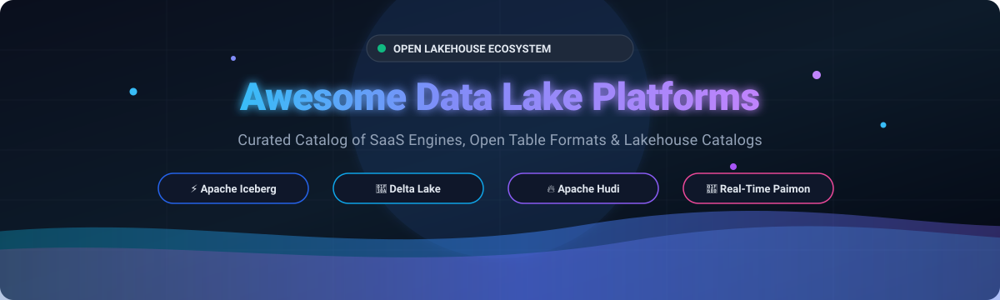

  

  
  
  
  
  

# 🌊 Awesome Data Lake Platforms

> 🚀 **A curated directory of top Data Lake Platforms, Lakehouse Architectures, Open Table Formats (Apache Iceberg, Delta Lake, Apache Hudi, Apache Paimon), Distributed Query Engines, and Metadata Catalogs.**

**Last updated:** October 2026 📅

This repository tracks notable **SaaS platforms** ☁️ and **open-source projects** 🛠️ for building high-performance **Data Lake** and **Lakehouse** architectures on cloud object storage (Amazon S3, Azure Data Lake Storage Gen2, Google Cloud Storage). These technologies bring ACID transactions, real-time streaming ingestion, schema evolution, partition pruning, time travel, and multi-engine interoperability without vendor lock-in.

---

## 📑 Table of Contents

- [📊 Sector Overview & Market Dynamics](#-sector-overview--market-dynamics)
- [☁️ SaaS / Hosted Platforms](#️-saas--hosted-platforms)
- [🛠️ Open-Source GitHub Projects](#️-open-source-github-projects)
- [📈 Star History](#-star-history)
- [🤝 How to Contribute](#-how-to-contribute)
- [💖 Support & Sponsorship](#-support--sponsorship)
- [⚠️ Disclaimer](#️-disclaimer)

---

## 📊 Sector Overview & Market Dynamics

The global data lake and lakehouse market is estimated at approximately **$18B to $24B in 2026** (scaling from ~$16B–$19B in 2024–2025 at a >20% CAGR, on trajectory toward $70B+ by the early 2030s). The sector exhibits a **hybrid market structure with high concentration among top cloud hyper-scalers and platform titans** (Databricks, Snowflake, AWS, Microsoft, Google capturing the vast majority of enterprise spend), coexisting with a **moderately fragmented ecosystem** of independent query engines, specialized catalogs, and open table formats (Apache Iceberg, Delta Lake, Trino) competing for multi-cloud and vendor-neutral deployments.

## ☁️ SaaS / Hosted Platforms

| Platform | Company | Company Size (Valuation / Revenue) | Description | Starting Pricing (Specific Tier) | Free Tier Limits / Free Trial |
| :--- | :--- | :--- | :--- | :--- | :--- |
| **[Microsoft OneLake (Fabric)](https://www.microsoft.com/en-us/microsoft-fabric)** | Microsoft | **~$3.1 Trillion** market cap | Unified data lake for Microsoft Fabric with OneLake Shortcuts, native Delta Lake/Iceberg format support, and direct Power BI / Office 365 integration. | **$0.36/hour** (Pay-as-you-go for entry **F2 Capacity** [2 CUs @ $0.18/CU-hour]; OneLake storage from $0.023/GB/month) | **60-day free trial** with full platform access (provisioned at F4/F64 capacity equivalence) and up to **1 TB OneLake data storage**. |
| **[Google BigQuery](https://cloud.google.com/bigquery)** | Alphabet (Google) | **~$2.1 Trillion** market cap | Fully managed, serverless enterprise data warehouse and lakehouse engine with native Apache Iceberg table support and BigQuery Omni cross-cloud queries. | **$6.25 per TB** scanned (On-Demand query pricing; storage at $0.02/GB/month active) | **Perpetual Free Tier**: **1 TB of query data processed per month** and **10 GB of active storage per month** free forever. |
| **[AWS Lake Formation](https://aws.amazon.com/lake-formation/)** | Amazon (AWS) | **~$1.9 Trillion** market cap | Centralized permissions, security governance, and access control for data lakes on S3, featuring S3 Tables with native Apache Iceberg support. | **$0/month** core governance plane; Storage Optimizer compaction billed at **$0.44 per DPU-hour** | **Perpetual Free Tier**: Lake Formation permissions and catalog governance are **100% free ($0)**; underlying AWS Glue Data Catalog includes **1M objects & 1M requests/month free**. |
| **[Snowflake](https://www.snowflake.com/)** | Snowflake Inc. | **~$45 Billion** market cap (~$3.6B ARR) | Cloud data platform supporting managed and unmanaged Apache Iceberg tables, open Apache Polaris catalog integration, and Snowflake Horizon governance. | **$2.00 per credit** (Standard Edition on-demand; compressed storage at $23/TB/month) | **30-day free trial** with **$400 in free usage credits** (no credit card required upfront; trial expires at 30 days or $400 consumption). |
| **[Databricks (Delta Lake)](https://www.databricks.com/)** | Databricks | **~$43 Billion** valuation (~$2.4B+ ARR) | The pioneer lakehouse platform built by the creators of Apache Spark. Features Unity Catalog for cross-engine governance and the Photon query execution engine. | **$0.15 per DBU** (Standard/Jobs batch compute; SQL Serverless from $0.70/DBU; All-Purpose compute from $0.40/DBU) | **14-day free trial** with **$400 in free DBU credits**; also provides a perpetual **Community/Free Edition** for learning (single serverless micro-cluster, 15GB RAM limit, non-production). |
| **[Cloudera](https://www.cloudera.com/)** | Cloudera (KKR / CD&R) | **~$5.3 Billion** take-private valuation (~$1B ARR) | Enterprise hybrid cloud data platform with lakehouse services (CDP) for data engineering, streaming, and multi-function analytics across private and public clouds. | **$0.04 to $0.07 per CCU-hour** (Cloudera Compute Unit: Data Hub @ $0.04/CCU-hr, Data Warehouse @ $0.07/CCU-hr; 1 CCU ≈ 1 vCPU + 4GB RAM) | **60-day free trial** for CDP Public Cloud (access to data hub, warehouse, and machine learning workspaces; cloud infrastructure billed separately). |
| **[Starburst Galaxy](https://www.starburst.io/)** | Starburst Data | **~$3.35 Billion** valuation | Fully managed cloud service powered by Trino for fast federated SQL queries across data lakes, catalogs, and hybrid multi-cloud databases without data movement. | **$0.40 to $0.55 per Galaxy Credit** (Standard/Pro compute execution; clusters consume credits based on size and uptime) | **Perpetual Free Tier**: **Up to 3 free concurrent clusters** and community support; also offers a **30-day Enterprise trial** with **$500 in free usage credits**. |
| **[Dremio](https://www.dremio.com/)** | Dremio | **~$2.0 Billion** valuation | Apache Iceberg-native lakehouse engine featuring an Iceberg REST Catalog, autonomous reflections for query acceleration, and engines that scale to zero. | **$0.20 per DCU** (Dremio Compute Unit: 2XS engine = 32 DCUs/hr @ $6.40/hr; XS engine = 64 DCUs/hr @ $12.80/hr; $0 storage fee when using customer S3/ADLS) | **Standard Community Tier** (free software/engine management with limits up to small engine sizes, 10 users per project); plus a **30-day Cloud trial** with **$400 in free compute credits**. |
| **[Tabular (Databricks)](https://tabular.io/)** | Databricks (Acquired) | **~$1.0 Billion+** acquisition price | Universal Iceberg storage and catalog management platform created by Apache Iceberg co-creators (Ryan Blue, Dan Weeks); acquired by Databricks in 2024. | **$0.15 to $0.70 per DBU** (Integrated into Databricks platform pricing via UniForm and managed Iceberg catalogs) | **14-day Databricks trial** with **$400 credits** for exploring Tabular-integrated Iceberg features on Databricks. |

## 🛠️ Open-Source GitHub Projects

Curated open-source projects for building sovereign, multi-engine lakehouses. Ranked by GitHub community popularity (⭐ descending):

- **[Apache Spark](https://github.com/apache/spark)**   
  ⚡ **Unified large-scale analytics engine** (Apache-2.0) — The distributed execution backbone behind Delta Lake and modern lakehouse ETL pipelines. Provides native SQL query optimization, distributed batch/streaming computation, and machine learning at petabyte scale.

- **[DuckDB](https://github.com/duckdb/duckdb)**   
  🦆 **In-process analytical database management system** (MIT) — The "SQLite for analytics." Natively queries Apache Iceberg, Delta Lake, and Parquet directly on object storage with vectorized columnar execution and zero client-server overhead.

- **[Apache Flink](https://github.com/apache/flink)**   
  🌊 **Stateful stream processing engine** (Apache-2.0) — Delivers event-driven processing and real-time CDC ingestion into lakehouse storage, acting as the primary stream processing engine for Apache Paimon and streaming Iceberg tables.

- **[Apache Arrow](https://github.com/apache/arrow)**   
  🏹 **Cross-language development platform for in-memory columnar data** (Apache-2.0) — The universal open standard for zero-copy memory sharing and high-throughput data interchange across lakehouse engines, catalogs, and analytical runtimes.

- **[Trino](https://github.com/trinodb/trino)**   
  🪐 **Fast distributed SQL query engine for big data** (Apache-2.0) — Powers federated lakehouse architectures, querying across Apache Iceberg, Delta Lake, Apache Hudi, and 40+ heterogeneous data systems without data movement.

- **[StarRocks](https://github.com/starrocks/starrocks)**   
  ⭐ **Next-generation sub-second MPP analytical database** (Apache-2.0) — Delivers real-time caching, vectorized execution, and ultra-fast direct SQL analytics over open lakehouse formats (Iceberg, Delta Lake, Hudi) on cloud object storage.

- **[Apache DataFusion](https://github.com/apache/datafusion)**   
  🦀 **Extensible, high-performance analytical query engine in Rust** (Apache-2.0) — Uses Apache Arrow for memory representations; widely embedded in next-generation lakehouse catalogs, modern data lake engines, and distributed compute frameworks.

- **[Apache Iceberg](https://github.com/apache/iceberg)**   
  🧊 **Open table format for huge analytic datasets** (Apache-2.0) — The industry standard for multi-engine interoperability created by Netflix. Features hierarchical metadata, O(1) atomic snapshots, hidden partitioning, schema evolution, and open REST catalog compatibility supported by Snowflake, BigQuery, Spark, Trino, and DuckDB.

- **[Delta Lake](https://github.com/delta-io/delta)**   
  💎 **Open-source ACID storage layer for data lakes** (Apache-2.0) — The Spark-native lakehouse foundation engineered by Databricks. Uses an append-only JSON transaction log (`_delta_log`), supports multi-writer coordinated commits, and provides UniForm for reading Delta tables directly as Iceberg metadata.

- **[Apache Hudi](https://github.com/apache/hudi)**   
  🔥 **Streaming data lake platform** (Apache-2.0) — The record-level mutation specialist engineered for CDC-heavy streaming architectures. Offers timeline-based metadata, Copy-on-Write / Merge-on-Read tables, and near-O(1) Record Index lookups across trillion-row tables.

- **[Apache Paimon](https://github.com/apache/paimon)**   
  🚀 **Streaming lake format for real-time lakehouses** (Apache-2.0) — Combines LSM-tree architectures with cloud storage for millisecond primary-key updates, native Flink streaming integration, and multimodal Blob Table storage for AI weights and vectors.

- **[Apache Gravitino](https://github.com/apache/gravitino)**   
  🌐 **Federated metadata lake and catalog** (Apache-2.0) — Top-level Apache project offering unified governance across multi-engine lakehouse tables, AI/ML models, filesystems, and Kafka streaming topics with credential vending.

- **[Apache Polaris](https://github.com/apache/polaris)**   
  ❄️ **Open-source Iceberg REST catalog** (Apache-2.0) — Originated by Snowflake and incubated under Apache. Provides multi-engine interoperability, multi-cloud credential vending, and open table-level access control.

- **[Lakekeeper](https://github.com/lakekeeper/lakekeeper)**   
  🛡️ **High-performance Rust Iceberg REST catalog** (Apache-2.0) — Ultra-lightweight Iceberg catalog with built-in OpenFGA role-based access control, secure credential vending, and Docker playground deployment.

- **[Apache XTable](https://github.com/apache/incubator-xtable)**   
  🔄 **Cross-table format translation engine** (Apache-2.0) — Provides bi-directional metadata translations across Apache Iceberg, Delta Lake, and Apache Hudi without duplicating underlying Parquet data files.

---

## 📈 Star History

---

## 🤝 How to Contribute

Contributions are warmly welcome! 💡

1. 🍴 Fork the repository.
2. 🌿 Create a feature branch: `git checkout -b feature/new-lakehouse-tool`.
3. 📝 Add or update entries in `README.md` (keep descriptions objective, link official sites, and follow the existing format).
4. 📤 Submit a Pull Request with a clear description of the project.

---

## 💖 Support & Sponsorship

If you find this curated ecosystem guide helpful for your lakehouse journey, please consider:
- ⭐ **Starring** this repository to show your support
- 🍴 **Forking** and contributing new tools or corrections
- 📢 **Sharing** this repository with fellow data engineers and platform architects
- ☕ Buying a coffee or becoming a sponsor via the [GitHub Sponsor Dashboard](https://github.com/sponsors/ishandutta2007)!

---

## ⚠️ Disclaimer

- This is a **community-curated** list — not exhaustive and not an endorsement.
- Data lake platforms handling enterprise data must comply with data protection regulations (GDPR, CCPA, etc.) and implement appropriate access controls and governance.
- **The table format choice should be driven by workload, not hype.** **Iceberg for multi-engine analytics** where organizations query the same tables from Trino, Snowflake, Flink, and Spark side by side. **Delta Lake for Spark-centric pipelines** needing multi-table transactions and deep Databricks integration. **Hudi for high-frequency record-level upserts** and CDC replication where purpose-built indexing outperforms general-purpose merge operations. **Paimon for real-time streaming lakehouse** where LSM-based updates and millisecond latency matter.
- **The format war is effectively over.** Databricks acquired Tabular; Snowflake open-sourced Polaris and made Iceberg tables GA; AWS shipped S3 Tables with native Iceberg support; BigQuery added managed Iceberg tables. UniForm lets Delta tables be read as Iceberg. The practical question is no longer "which format wins"—it's "which format fits my engine ecosystem."
- **The "free" open-source format has operational costs.** Compaction, snapshot retention, metadata cleanup, and orphan-file controls are unmanaged in a bare object storage plus table format setup. Production tables need incremental processing on ingestion-matched intervals paired with scheduled vacuum and snapshot expiration outside peak query hours.
- Self-hosted open-source solutions require proper infrastructure management, compaction scheduling, and ongoing maintenance.

---

**Made with ❤️ for data engineers, platform architects, and organizations building modern lakehouse solutions.**  
*Let's make Data Lake Platforms open, transparent, and interoperable!* 🚀
